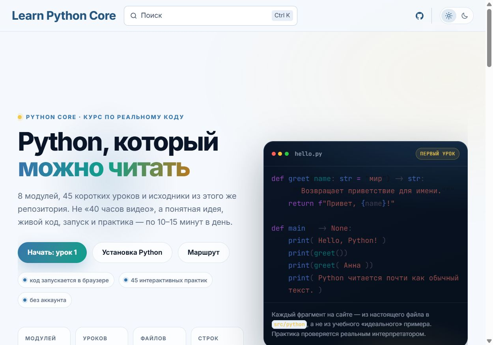
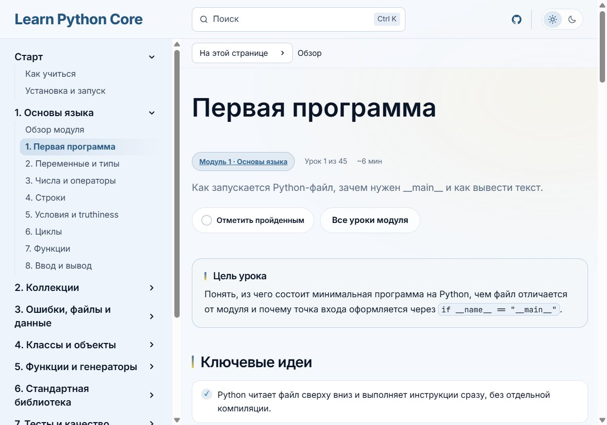
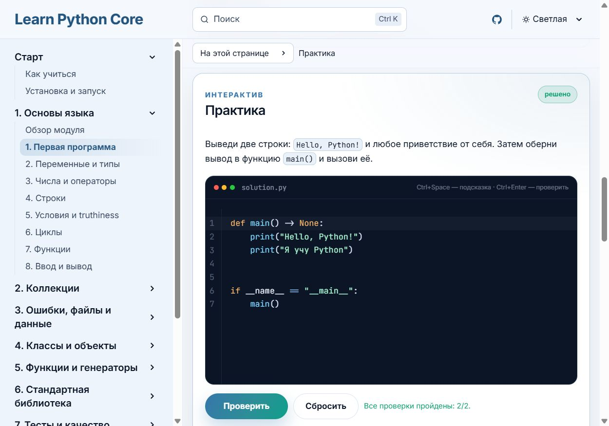
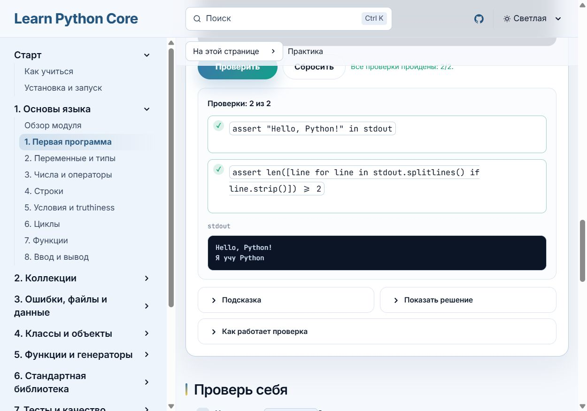

# Learn Python Core

Курс по Python с нуля до первого веб-API: **9 модулей, 62 урока, 62 запускаемых файлов**. Внутри — реальные исходники из этого же репозитория, интерактивная практика с запуском Python в браузере, прогресс и самопроверка.

Сайт: **https://baileyseye.github.io/learn-python-core/**

| [](screenshots/home-full.jpg) **Главная** — маршрут, прогресс и девять карточек модулей | [](screenshots/lesson.jpg) **Урок** — цель, идеи, реальный код, вывод программы, практика и квиз |
| --- | --- |
| [](screenshots/practice.jpg) **Редактор** — подсветка Python, подсказки, сохранение черновика | [](screenshots/practice-result.jpg) **Проверка** — реальный запуск через Pyodide и тесты по каждому условию |

## Что внутри

- **Уроки из реального кода.** Каждый фрагмент на сайте — срез файла из `src/python`, номера строк совпадают. Сайт не хранит отдельные «учебные» копии.
- **Интерактивная практика.** Редактор CodeMirror с подсветкой Python, запуск через Pyodide (Python в WebAssembly) и настоящие тесты. Сложные задачи разбиты на шаги 1–2 с отдельными проверками, основная задача — шаг 3. Код не отправляется на сервер.
- **Честный вывод программ.** Скрипт синхронизации запускает каждый файл и сохраняет реальный stdout.
- **Прогресс в localStorage** с экспортом и импортом JSON.
- **Тёмная и светлая темы**, мобильная версия, поиск Starlight.
- **Справочник:** шпаргалка, сравнение с Java, частые ошибки.
- **Для автора:** инвентарь файлов и карта маршрута.

## Программа

| # | Модуль | Темы |
| --- | --- | --- |
| 1 | Основы языка | чтение кода, первая программа, функции, переменные, словари, числа, строки, условия, циклы, ввод-вывод |
| 2 | Коллекции | срезы, списки, кортежи, словари, множества, comprehensions, lambda/key, сортировка |
| 3 | Ошибки и файлы | исключения, файлы, JSON/CSV |
| 4 | Классы и объекты | классы, свои ошибки, dataclass, property, наследование, композиция, dunder, протоколы |
| 5 | Функции и генераторы | *args/**kwargs, замыкания, декораторы и декораторы с параметрами, итераторы, генераторы, контекстные менеджеры, itertools |
| 6 | Стандартная библиотека | datetime, collections, re, random/statistics, logging |
| 7 | Тесты и качество | venv, pytest, практика тестов, типы, отладка, структура проекта, мини-проект |
| 8 | Веб и фреймворки | HTTP-клиент, HTTP-сервер, Pydantic, FastAPI, SQLite, SQL-практикум, async/await, gather |
| 9 | За пределами ядра | потоки, процессы и async, GIL и внутреннее устройство, фикстуры и mock, алгоритмы и структуры данных |

## Быстрый старт

### Только Python

Нужен Python 3.11+ (проверено на 3.12+). Большинство примеров используют только стандартную библиотеку; для модулей 7–8 нужны `pytest`, `fastapi` и `pydantic` — они ставятся через `pip`.

```bash
py src/python/basics/01_hello.py
```

На macOS/Linux:

```bash
python3 src/python/basics/01_hello.py
```

### Сайт курса

Нужен Node.js 20+.

```bash
npm install
npm run dev
```

Сайт откроется на `http://localhost:4321/learn-python-core/`.

Production-сборка:

```bash
npm run build
npm run preview
```

## Как открыть в редакторе

### VS Code

1. Установите расширение **Python**.
2. Откройте папку `learn-python-core`.
3. Запускайте файлы кнопкой **Run Python File** или `Ctrl+F5`.

### PyCharm Community

1. **Open** → папка `learn-python-core`.
2. Выберите интерпретатор Python 3.11+.
3. Запускайте файл зелёной стрелкой.

### IntelliJ IDEA

В репозитории есть общие Run Configurations в `.run/`:

- **Frontend: dev** — `npm run dev`;
- **Frontend: build** — `npm run build`.

Python-файлы IDEA откроет как текст; для запуска нужен плагин Python или терминал.

## Команды

```bash
npm run dev            # синхронизация данных + Astro dev server
npm run sync           # пересобрать generated.json из src/python
npm run check:data     # проверить, что generated.json не устарел
npm run check:practice # прогнать эталонные решения через их тесты
npm run check:pyodide  # прогнать все решения и шаги в реальном Pyodide
npm run build          # production-сборка в dist/
npm run preview        # локальный просмотр сборки
```

Также можно запустить тесты Python напрямую:

```bash
py -m pytest
```

## Как это устроено

Python-исходники в `src/python` — единственный источник правды.

1. `scripts/extract-sources.py` читает AST: функции, классы, методы, диапазоны строк.
2. `scripts/sync-course-data.mjs` запускает каждый файл и записывает реальный вывод в `site/src/data/generated.json`.
3. Метаданные уроков лежат в `site/src/data/lessons/module-*.mjs`: цель, идеи, ссылки на функции, практика, квиз.
4. Скрипт проверяет, что каждая ссылка `focus.function` существует, а файл запускается. Если нет — сборка падает с понятной ошибкой.
5. Astro Starlight собирает статический сайт.

### Интерактивная проверка

Практика выполняется в Web Worker:

1. Загружается Pyodide с jsDelivr (около 10 МБ, один раз на вкладку).
2. Код пользователя выполняется через `exec`, stdout перехватывается.
3. Тесты из урока выполняются в том же namespace.
4. Результаты по каждому тесту возвращаются в интерфейс.
5. Без интернета включается структурная проверка (скобки, TODO, близость к эталону), но она не выполняет код.

## Структура

```text
learn-python-core/
├── src/python/                 # 62 учебных файла
│   ├── basics/
│   ├── collections/
│   ├── errors/
│   ├── oop/
│   ├── functional/
│   ├── stdlib/
│   ├── testing/
│   ├── web/
│   └── advanced/
├── site/src/
│   ├── components/             # Astro-компоненты
│   ├── content/docs/           # старт, справочник, «что дальше»
│   ├── data/
│   │   ├── modules.mjs
│   │   ├── lessons/module-1..9.mjs
│   │   ├── course.mjs
│   │   ├── sidebar.mjs
│   │   └── generated.json      # генерируется
│   ├── pages/
│   ├── scripts/                # CodeMirror, Pyodide, прогресс, квиз
│   └── styles/custom.css
├── scripts/
│   ├── extract-sources.py
│   └── sync-course-data.mjs
├── .github/workflows/deploy-course.yml
├── astro.config.mjs
├── ec.config.mjs
└── package.json
```

## Добавить урок

1. Создайте файл в `src/python/<модуль>/` с функциями и `main()`.
2. Добавьте урок в `site/src/data/lessons/module-N.mjs`:

```js
{
  id: 'my-lesson',
  title: 'Моя тема',
  summary: 'О чём урок.',
  minutes: 8,
  goal: 'Что читатель поймёт.',
  ideas: ['идея 1', 'идея 2'],
  sources: [{ file: 'basics/my_file.py', focus: [{ function: 'my_function', note: '...' }] }],
  practice: {
    task: 'Напиши функцию...',
    hint: 'Подсказка.',
    starter: 'def my_function():\n    pass\n',
    solution: 'def my_function():\n    return 42',
    tests: ['assert my_function() == 42']
  },
  quiz: [{ q: '...', options: ['a', 'b'], answer: 0, explain: '...' }]
}
```

3. Выполните `npm run sync` и `npm run dev`.

Тесты практики — обычные Python-выражения. В них доступна переменная `stdout` с захваченным выводом.

## Деплой

Workflow `.github/workflows/deploy-course.yml` собирает сайт и публикует `dist` на GitHub Pages.

В настройках репозитория: **Settings → Pages → Source: GitHub Actions**.

Если репозиторий называется иначе, измените `base` в `astro.config.mjs` и `githubSourcePath` в `site/src/utils/url.js`.

## Лицензия

MIT. Смотрите [LICENSE](LICENSE).
